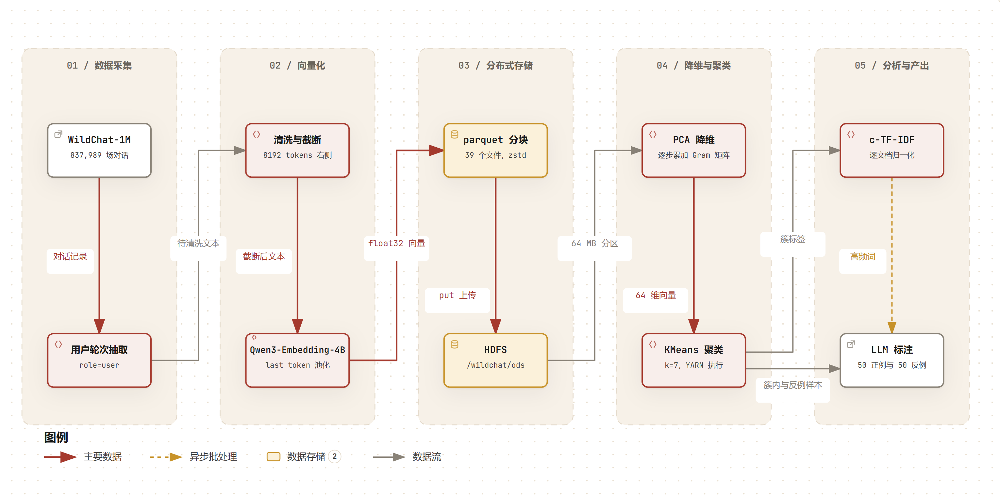
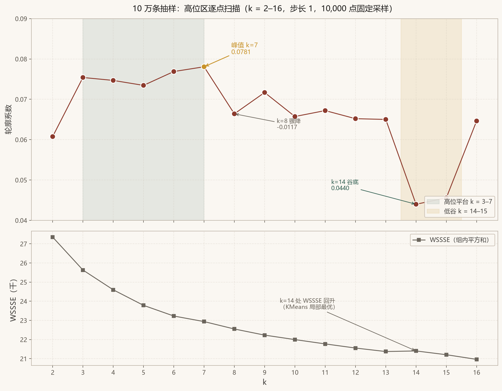
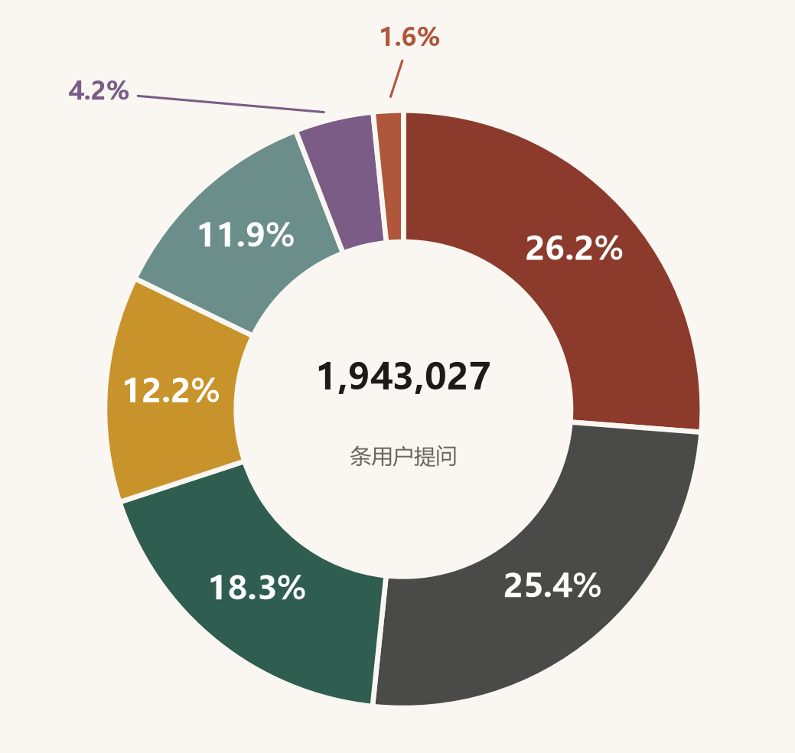
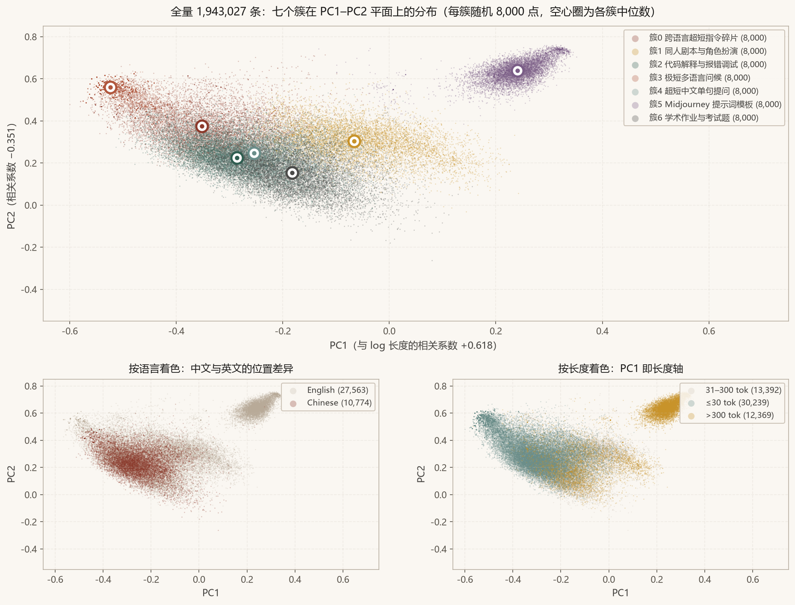
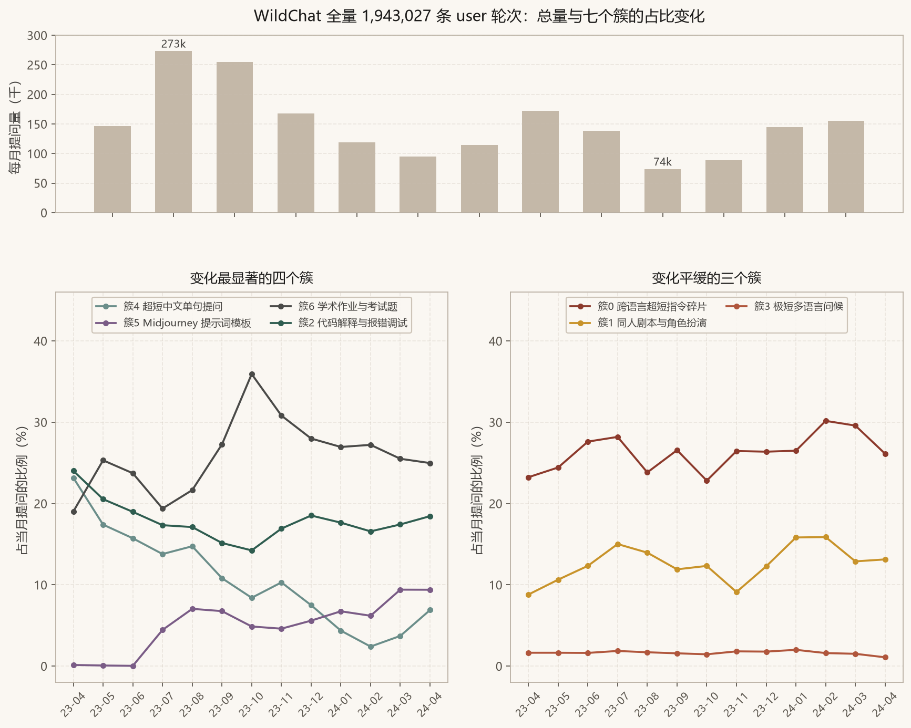
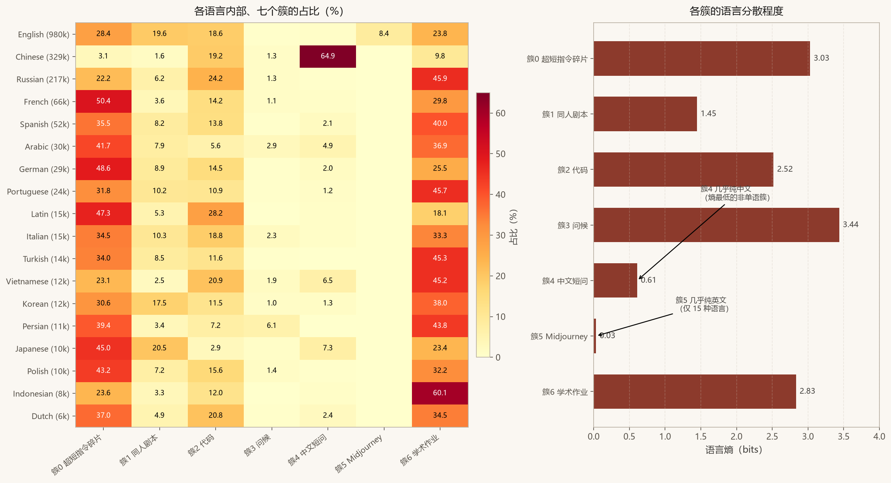

# WildChat-1M 使用模式聚类分析

## 项目概况

这个项目把 WildChat-1M 里的 194 万条用户提问编码成 2560 维向量，在三节点 Hadoop 与 Spark
集群上做降维和聚类，把提问分成七种使用模式，再从时间和语言两个角度分析这些模式如何分布与变化。
全部计算在集群上完成，作业以 YARN 方式提交，中间结果存放在 HDFS。

数据的字段、截断规则、分词与停用词的做法写在 [数据处理方法.md](数据处理方法.md)。
集群规格以及与课程实验环境的差异写在 [配置记录.md](配置记录.md)。

## 数据

WildChat-1M 收录了 837,989 场真实人机对话，来自公开的聊天服务，覆盖 68 种语言，
时间从 2023 年 4 月到 2024 年 4 月。

项目只保留用户一侧的提问。逐轮抽取 role=user 的内容之后，得到 1,943,027 条提问，
超长的文本按 8192 个 token 从右侧截断，截断标记单独存一个字段。

原始 parquet 合计 3.2 GB，没有放进仓库，需要在
[HuggingFace 的 allenai/WildChat-1M](https://huggingface.co/datasets/allenai/WildChat-1M)
下载后放进 `data/`。

## 处理流程

数据从原始对话到簇名与交叉分析的完整流向见图 1。前后两个阶段在宿主机上完成，中间的存储、
降维、聚类与关键词统计跑在三节点集群上。

图 1 从 837,989 场对话到簇名与分析结果的数据流。绿色实线是主要数据，紫色虚线是两路标注的交叉验证。
可交互的版本见 [figures/dataflow.html](figures/dataflow.html)，支持切换明暗主题与缩放。

第一步，在宿主机上用 Qwen3-Embedding-4B 把每条提问编码成 2560 维向量，写成 39 个 parquet
文件，合计 17 GB，然后上传到 HDFS。

第二步，用 Spark MLlib 拟合 PCA，把 2560 维压到 64 维，累计解释方差 0.3921。
降维之后的数据只占 0.93 GB，可以在 12 GB 的 executor 内存里反复迭代。

第三步，用 KMeans 对全量数据聚类。k 值先在 10 万条抽样上确定，从 k=2 扫到 64，
再在高位区逐点加密，每档用同一份 10,000 点固定采样计算轮廓系数。

图 2 在 10 万条抽样上的 k 值扫描。峰值落在 k=7，k=8 时轮廓系数下降 0.0117。

k=7 时对全量 1,943,027 条聚类，在 YARN 上运行约 9 分钟，轮廓系数 0.0779。

## 七种使用模式

七个簇的规模与占比见图 2。规模最大的是跨语言超短指令碎片，占 26.2%；
其次是多语种学术作业解答 25.4%，代码解释与报错调试 18.3%。前三个簇合计 69.9%。

图 3 七个簇的占比。前三个簇合计 69.9%，长篇创作相关的两个簇合计 16.4%。

每个簇的名称由两路标注对照得出。一路用 c-TF-IDF 提取簇内高频词，另一路让大模型读 50 条
簇内样本和 50 条最接近质心却被判给其他簇的反例，分别给出簇名。七个簇里五个一致，两个不一致，
分歧集中在写作类指令和作业套话上。

## 语义空间中的位置

把 PCA 的前两个主成分作坐标，每簇随机取 8,000 点画散点，结果见图 3。
第一主成分与文本长度的相关系数是 0.618，长度是这个空间里的主导方向。

图 4 七个簇在前两个主成分平面上的分布。只有 Midjourney 提示词簇单独成团，其余六个簇首尾相接。

六个簇连成一条带，说明簇与簇之间是渐变的，没有天然断层。这也解释了轮廓系数只有 0.0779。

## 使用模式随时间的变化

占比按当月总量归一化之后，十三个月里有四个簇变化明显，三个基本平稳，见图 4。

图 5 七个簇的月度占比。Midjourney 提示词簇在 2023 年 7 月出现，中文短句提问簇持续萎缩。

中文短句提问簇从 23.2% 掉到 2.4%，是变化最大的一个。拆开看，中文提问里落在该簇的比例
首月是 68.5%，末月是 69.2%，中间十一个月在 56% 到 71% 之间，用户行为没有明显变化；
同期中文提问占当月总量的比例从 32.6% 跌到 3.4%。这个簇的萎缩来自中文用户数量减少。

## 不同语言的使用模式

数据里有 73 种轮级语言，其中 33 种样本超过 2,000 条。各语言在七个簇上的分布见图 5。

图 6 各语言在七个簇上的分布与各簇的语言熵。中文有 64.9% 的提问落在同簇，印尼语等语言偏向学术作业。

中文提问有 64.9% 落在中文短句提问簇，其他语言都不超过 7.4%。印尼语 60.1%、俄语 45.9%、
葡萄牙语 45.7%、土耳其语 45.3% 的提问落在学术作业簇，英语是 23.8%，中文是 9.8%。

## 文档与代码

| 文件 | 内容 |
| --- | --- |
| [数据处理方法.md](数据处理方法.md) | 数据字段、截断、分词、停用词、轮廓系数的完整说明 |
| [配置记录.md](配置记录.md) | 集群规格与课程实验环境的差异 |
| [CHANGELOG.md](CHANGELOG.md) | 做过什么，含缺陷与修正的过程 |
| [发现记录-全量-k7.md](发现记录-全量-k7.md) | 全量聚类结果、两路标注对照、时间与语言的完整数据 |
| [docker/README.md](docker/README.md) | 集群镜像如何构建，集群如何启动 |
| [scripts/](scripts/) | 向量化、降维、聚类、分析与绘图的脚本 |
| [out/](out/) | 分析过程输出的 CSV 与 JSON |
| [CS4303-课程项目-WildChat聚类分析.pdf](CS4303-课程项目-WildChat聚类分析.pdf) | 课程项目幻灯片导出的提交件 |

脚本按处理阶段分为几组。向量化是 `embed_full_corpus.py`，转 parquet 是 `to_parquet.py`，
降维是 `pca_full.py`，聚类是 `cluster_full.py`，k 值扫描是 `k_scan.py` 与 `k_bisect.py`，
关键词统计是 `ctfidf_v3.py`，轮廓系数复核是 `silhouette_compare.py`，
时间与语言分析是 `time_lang.py` 与 `lang_topic.py`，绘图是 `plot_*.py`。

脚本按项目根目录为工作目录运行。过程中用过的一次性脚本留在本机，没有公开。

## 依赖

Python 侧需要 pyarrow、jieba、stopwordsiso、scikit-learn、matplotlib 和 python-pptx。
集群侧使用 Hadoop 3.3.6 与 Spark 3.5.5，镜像基于 Ubuntu 24.04。
